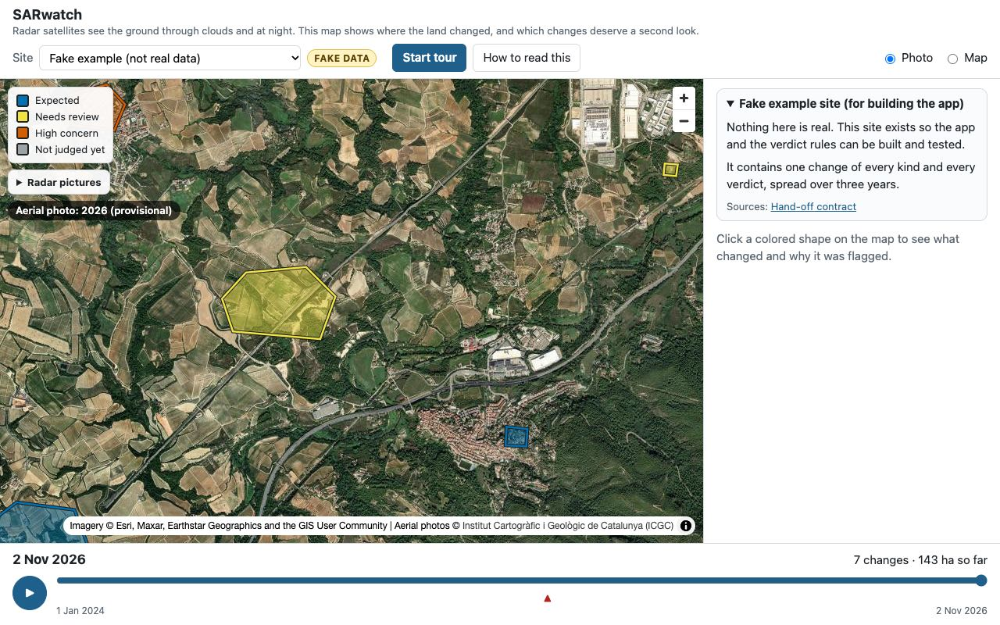

# Parallax (Dancing with the SARs)

Parallax is a tool that uses **radar satellites** (NASA-ISRO **NISAR** and Copernicus **Sentinel-1**) to find where
the land surface changed, and to tell a regulator **which changes look expected and which need a look**. It works for any
place: a site is a folder of plain data files, and the app shows whichever sites it finds. Built for the NASA Space Apps
Challenge 2026.



*The app on its clearly labelled fake example site (the screenshot shows no real data).*

Example sites: a forest area in northern Finland and the Barcelona metropolitan region.

## What it does

- **Radar sees through clouds and at night**, so it can follow a site month after month where optical photos cannot.
- It finds where the ground changed: **forest clearing, new buildings, earthworks**.
- Public records give each change a label: **expected**, **needs review** or **high concern**, in plain language, with
  the reasons (protected areas, zoning, cadastre, solar-plant list, other official records) and their sources next to
  the radar evidence. The app shows reasons; it never judges legality.
- Click a change to see a before/after swipe and the radar signal over time; move the time slider to replay the site.

Product brief: [kb/product.md](kb/product.md) · plan: [kb/plan.md](kb/plan.md) ·
new to radar? [kb/sar-primer.md](kb/sar-primer.md).

## Run it

The app is static (no build step, no npm, no API keys):

```
python -m http.server 8000 -d app      # then open http://localhost:8000
```

Add `#site=<id>` to the URL to open a site directly. Sites with `"ready": true` in `app/data/sites.json` appear in the
switcher. App notes: [app/README.md](app/README.md).

On GitHub Pages it is served from `https://space0code.github.io/dancing-with-the-sars/`; the workflow
`.github/workflows/pages.yml` publishes `app/` as it is.

## Rebuild the data

The app reads plain files in `app/data/` (format: [kb/data-contract.md](kb/data-contract.md)). The Python package in
`src/sarwatch/` makes them from real radar data.

```
pip install -e '.[radar,verdict,dev]'              # Python 3.11+
export EARTHDATA_TOKEN=...                         # free NASA Earthdata Login token (urs.earthdata.nasa.gov > Generate Token)
python -m sarwatch.pipeline <site-id>              # NISAR + Sentinel-1 -> app/data/<site-id>/
python -m sarwatch.contract app/data               # check that the files follow the contract
python -m pytest                                   # tests (offline)
```

Radar files are large (NISAR granules are 2-7 GB): the readers fetch only the site's window, and cache small per-date
files under `data/` (gitignored). The fake example site comes from `explore/fixture/make_fixture.py`. A Codespace setup
is in `.devcontainer/`.

## Add a site

1. Add the site to `app/data/sites.json`: `id` (lowercase slug), `name`, `country`, `center`, `zoom`, `bbox`, and
   optionally `notes` (up to 4 short, neutral notes about the data, such as what the satellites cover and known limits).
2. Add its settings (window, NISAR track and frame, change thresholds, `notes`) to `SITES` in
   `src/sarwatch/pipeline.py`; `kb/site-barcelona.md` is a worked example of choosing them.
3. Run `python -m sarwatch.pipeline <site-id>`. It writes `app/data/<site-id>/` (changes, pictures, signal series) and
   marks the site ready in `sites.json`; `python -m sarwatch.contract app/data` checks the result.
4. Records for the labels (zoning, protected areas and so on) come from `src/sarwatch/context/` and
   `src/sarwatch/verdict.py` (rules: [kb/verdict-rules.md](kb/verdict-rules.md)).

## Data sources and credits

| What | Provider | Terms |
|---|---|---|
| NISAR L-band radar (GCOV) | NASA / ISRO, via the [ASF DAAC](https://asf.alaska.edu) | open NASA data |
| OPERA RTC-S1 (Sentinel-1 radar backscatter) | NASA JPL, via ASF | open NASA data |
| Sentinel-1 / Sentinel-2 | [Copernicus](https://www.copernicus.eu) programme (ESA / European Commission) | free, full and open |
| Landsat 8 / 9 | NASA and USGS | open data |
| OPERA DIST-ALERT-HLS (optical alerts) and HLS colour photos | NASA, made from Landsat (NASA / USGS) and Sentinel-2 (ESA), via NASA LP DAAC | open NASA data |
| Year photos in Catalonia | [ICGC](https://www.icgc.cat) aerial orthophotos (WMS) | attribution shown in the map; see ICGC's terms |
| Year photos elsewhere | [EOX](https://cloudless.eox.at) Sentinel-2 cloudless, "Contains modified Copernicus Sentinel data" | CC BY 4.0 (2017), CC BY-NC-SA 4.0 (2018 on) |
| Background maps | Esri World Imagery; © OpenStreetMap contributors | see each provider's terms |
| Records for the verdict | Catalan protected areas (PEIN / Natura 2000), MUC zoning (Generalitat), Spanish cadastre (INSPIRE), the Catalan solar-plant list, the official records cited per change | public registers; sources listed in [kb/data-sources.md](kb/data-sources.md) |

The EOX layers from 2018 on are non-commercial (CC BY-NC-SA): fine for this challenge, check before any commercial use.

## Licence

Code and text: [MIT](LICENSE). Data and imagery keep their providers' terms (table above).

## Team and how we work

Tian ([`TianK003`](https://github.com/TianK003)), Tomi ([`Space0code`](https://github.com/Space0code)),
Andrea ([`molte38`](https://github.com/molte38)). Each of us drives a Claude Code agent; the agents coordinate
through GitHub Issues and keep the knowledge base in `kb/`. Rules: [AGENTS.md](AGENTS.md).

<sub>Written by Claude</sub>
