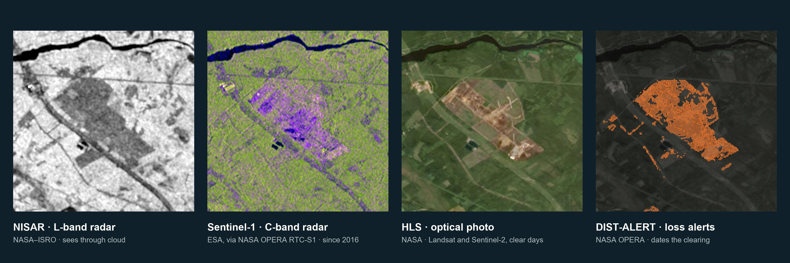

# Pitch pictures

`cloud-optical.jpg` (as fetched, 30 m) and `cloud-radar.jpg` (from `app/data/muhos/layers/`) show the same box near Muhos, Finland (64.79-64.88 N, 26.02-26.20 E); `cloud-pair.jpg` puts them side by side for a slide.
Optical: 20 Oct 2026, layer `HLS_S30_Nadir_BRDF_Adjusted_Reflectance`, fully covered by cloud. Radar: Sentinel-1 (C-band), a mean of 3 passes from 14 to 26 Oct 2026 (the app's "after" layer, dated 20 Oct), the ground is visible.
Credit, optical: imagery from NASA Worldview (NASA EOSDIS GIBS), product HLS (NASA; made from Landsat and Sentinel-2).
Credit, radar: Contains modified Copernicus Sentinel data (ESA, Copernicus), prepared as OPERA RTC-S1 (NASA).
Fetched with the public NASA Worldview Snapshots API using the radar picture's bounds.

`Radar_comparison.gif`: a screen recording of the app's Compare slider at Muhos, Finland, for a slide. Before: Sentinel-1, 2 Jun 2025; after: NISAR, 19 Jul 2026 (`frames/radar/2026-07-19-nisar.jpg`). Credit: NISAR (NASA/ISRO); Contains modified Copernicus Sentinel data (ESA, Copernicus), prepared as OPERA RTC-S1 (NASA).

`barcelona-demo.gif` (10 s, 960x540) and `barcelona-demo-still.png` (last frame): screen recording of the live app (Barcelona, Radar view) on 15 Nov 2026. The timeline runs from 5 Jun 2016 to 2 Nov 2026 and changes appear; then a click on barcelona-0073, a new building labelled Expected, and the "Why this label?" card scrolls through its reasons (registered buildings, derived from Dirección General del Catastro data; zoning, Mapa urbanístic de Catalunya) and their sources. Credit: Contains modified Copernicus Sentinel data (ESA, Copernicus), prepared as OPERA RTC-S1 (NASA); NISAR (NASA/ISRO). Background imagery © Esri and its providers.

`barcelona-demo-large.gif` (9.9 s, 1280x720, 10 fps) and `barcelona-demo-large-still.png` (last frame): larger re-take of the Barcelona clip for far-away viewing, recorded on 15 Nov 2026 from the live app. The timeline steps 14 dates from 2016 to 2 Nov 2026 at a close zoom; a click on barcelona-0033 (new building, 23 ha, Expected) opens its card: the card first shows the "Signal over time" section (heading, radar measurements chart, series legend, note), then "Why this label?" with the sources (registered buildings, Dirección General del Catastro; zoning, Mapa urbanístic de Catalunya). Credit: Contains modified Copernicus Sentinel data (ESA, Copernicus), prepared as OPERA RTC-S1 (NASA); NISAR (NASA/ISRO). Background imagery © Esri and its providers.

## `layers/`: the NASA data layers over one area (Muhos, same crop in all four tiles, 900x900 px)

- `layers-strip.jpg` (3600x1200): the four tiles in a row with captions, for the slide.
- `layer-nisar.jpg`: NISAR L-band radar, 19 Jul 2026, from `frames/radar/2026-07-19-nisar.jpg`. Credit: NISAR (NASA/ISRO).
- `layer-sentinel1.jpg`: Sentinel-1 C-band radar, a colour composite (mean of 3 passes, 14 to 26 Oct 2026, the app's Sentinel-1 "after" layer dated 20 Oct), from `app/data/muhos/layers/sentinel_1_c_band_after.png`, cropped to the same ground area as the other tiles by longitude/latitude (no marks, not retouched; the source is 290x302 px, so it is soft). Credit: Contains modified Copernicus Sentinel data (ESA, Copernicus), prepared as OPERA RTC-S1 (NASA).
- `layer-hls-photo.jpg`: optical photo, 27 Aug 2026, from `frames/photo/2026-08-27.jpg`. Credit: HLS (NASA; made from Landsat and Sentinel-2).
- `layer-dist-alert.jpg`: OPERA DIST-ALERT vegetation-loss alerts (dated 29 Apr to 31 Aug 2026) in orange over a darkened copy of the 27 Aug photo, from `changes.geojson`. Credit: OPERA DIST-ALERT-HLS (NASA).
